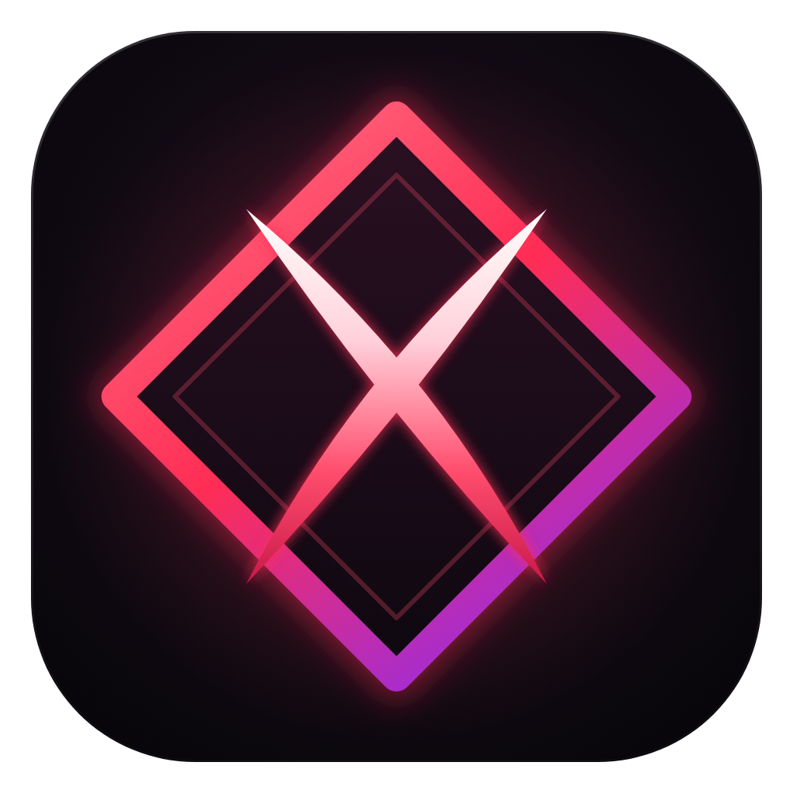
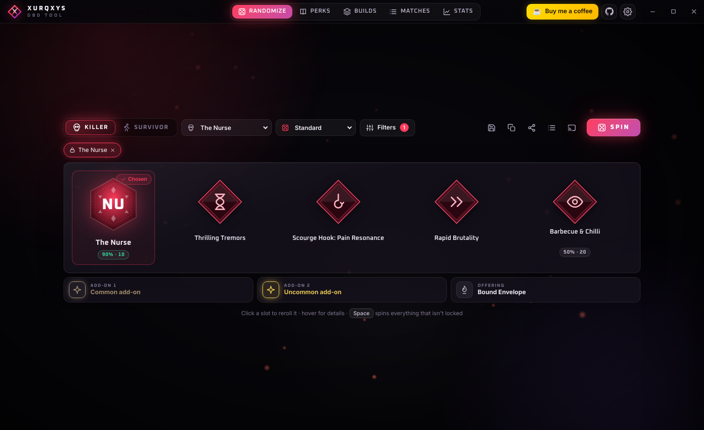
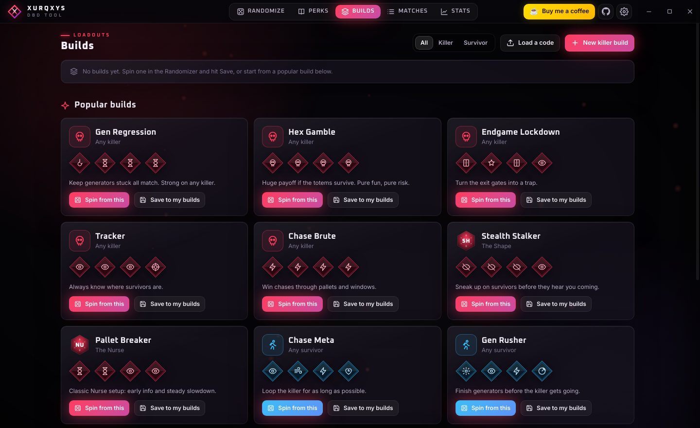
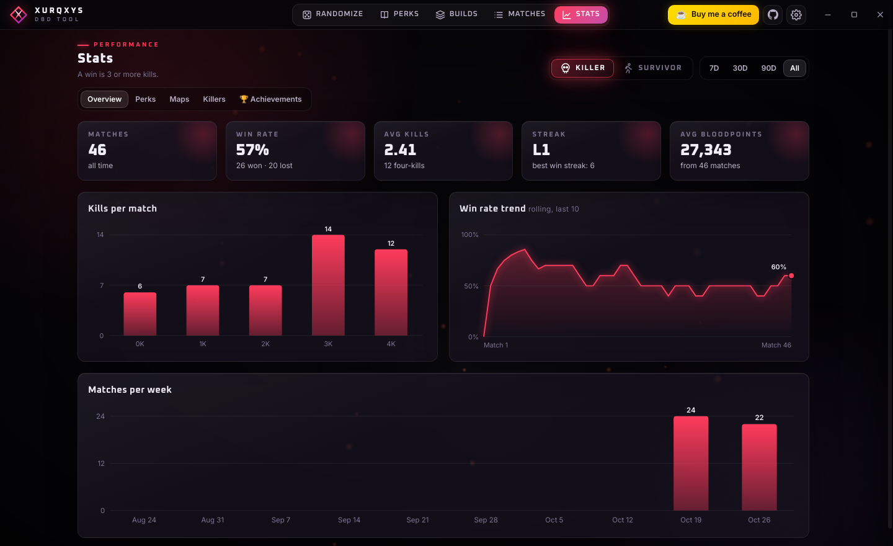
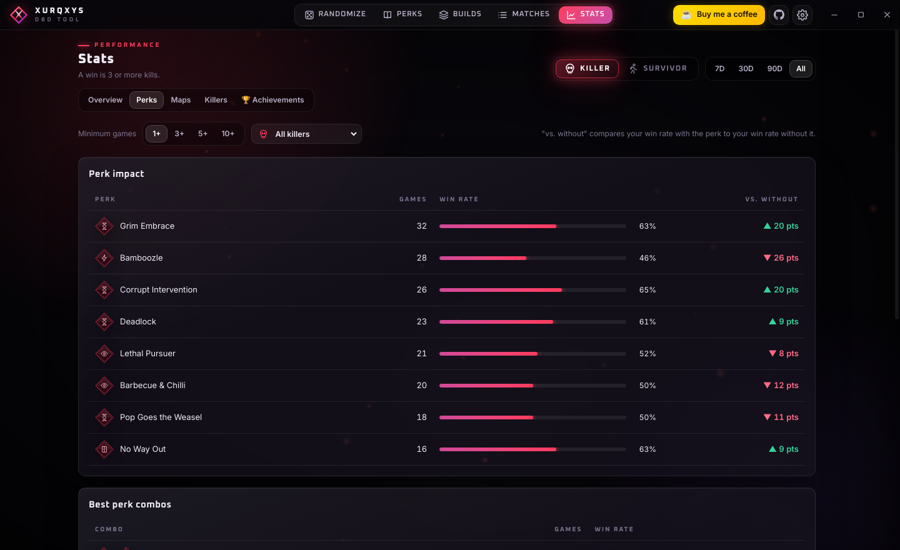
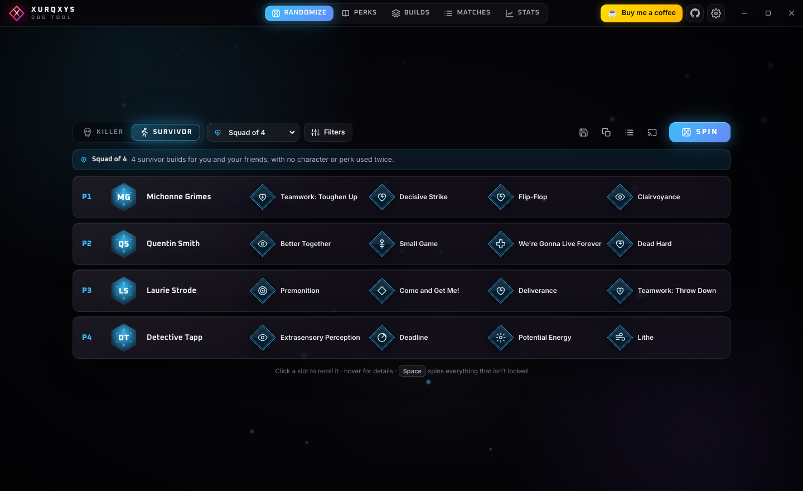
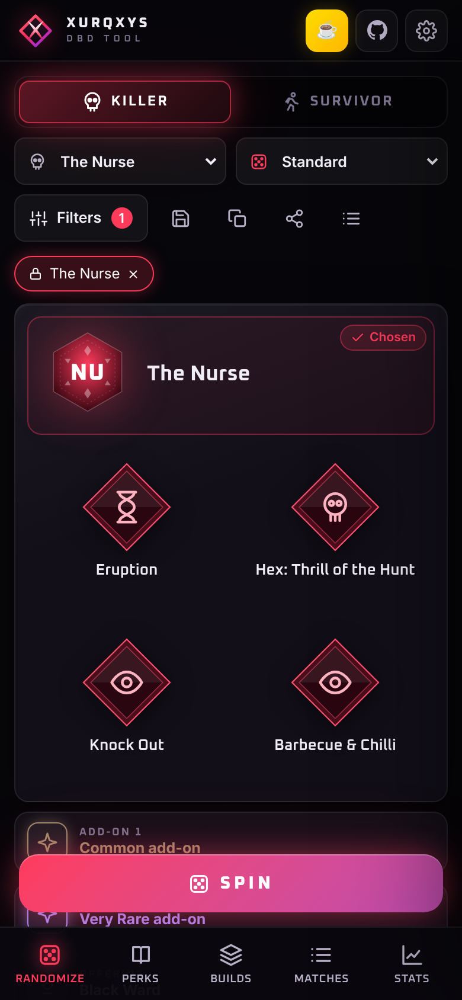

<p align="center">
  
</p>

<h1 align="center">Xurqxys DBD Tool</h1>

<p align="center">
  Free Dead by Daylight companion: build randomizer, perk database, match tracker and stats.<br>
  For <b>Windows</b>, <b>Android</b> and <b>iPhone</b>.
</p>

<p align="center">
  <a href="https://github.com/xurqxy/xurqxys-dbd-tool/releases/latest"><b>⬇ Download</b></a> ·
  <a href="https://xurqxy.github.io/xurqxys-dbd-tool/">Website</a> ·
  <a href="https://buymeacoffee.com/xurqxy">☕ Buy me a coffee</a> ·
  <a href="CHANGELOG.md">What's new</a>
</p>

<p align="center"></p>

## Download

| Device | Get it | |
|---|---|---|
| **Windows 10 / 11** | [`XurqxysDBDTool-x.y.z-Setup.exe`](https://github.com/xurqxy/xurqxys-dbd-tool/releases/latest) | Recommended. Pick a folder, starts fast, updates itself. |
| Windows, no install | [`XurqxysDBDTool-x.y.z.exe`](https://github.com/xurqxy/xurqxys-dbd-tool/releases/latest) | Portable single file (opens a little slower). |
| **Android 8+** | [`XurqxysDBDTool-x.y.z.apk`](https://github.com/xurqxy/xurqxys-dbd-tool/releases/latest) | Open on your phone, allow installing once. |
| **iPhone / iPad** | [Web app](https://xurqxy.github.io/xurqxys-dbd-tool/app/) | In Safari: Share → **Add to Home Screen**. |

**"Windows protected your PC"?** The app isn't code-signed yet, so SmartScreen warns at first: click **More info → Run anyway**.
Every download is built automatically by GitHub Actions from the code in this repository.

## Features
- **Randomizer** — random killer or survivor builds: character, 4 perks, item, add-ons (real names per killer) and offering.
  Pick your own killer or survivor, lock slots, reroll single slots, filter by theme, and play **challenge modes**
  (Adept, No Meta, Theme Roulette, Hex Only, No Perks, Mystery, Squad of 4).
- **Your own win rates on the build** — every rolled perk and character shows how well *you* do with it.
- **Popular builds** — ready-made meta builds to spin from or save.
- **Perk database** — every perk, killer and survivor, searchable, with categories.
- **Match log & stats** — one-click logging, win rate trends, perk impact, best combos, stats per map and character, 24 achievements.
- **Share builds** — short codes (`XQ-…`) and share images for Discord.
- **Streamer mode** — OBS overlay, always-on-top window and global hotkeys. Never touches the game.
- **Sound effects** and a **CPU saver**; uses no CPU while it's in the background.
- **5 languages** — English, Deutsch, Español, Português (BR), Français.
- **Official icons** — downloaded from the community [DBD Wiki](https://deadbydaylight.wiki.gg) on your own device, refreshed weekly.

| | |
|---|---|
|  |  |
|  |  |

<p align="center"></p>

## Privacy
Nothing is collected. Your matches, builds and settings stay on your device; the app only goes online to fetch game
data and icons from the DBD Wiki and to check for updates. Uninstalling on Windows removes everything (it asks before
deleting your saved data). Details: [PRIVACY.md](PRIVACY.md).

## License
Free to download and use. Please don't sell it, re-upload modified copies, or copy the code into other projects —
see [LICENSE.txt](LICENSE.txt). Open-source parts keep their own licenses: [THIRD-PARTY-NOTICES.txt](THIRD-PARTY-NOTICES.txt).

Xurqxys DBD Tool is a free fan project. It is **not affiliated with or endorsed by Behaviour Interactive**.
Dead by Daylight and its names, icons and artwork are trademarks and property of Behaviour Interactive.
No game assets are included in this repository or in the downloads.

---

## For developers

```
npm install
npm start               # run the desktop app
npm test                # dataset consistency check
npm run build:mobile    # phone web app into dist-mobile/
npm run dist:win        # protected Windows installer + portable exe
```

| Guide | |
|---|---|
| [docs/GITHUB-SETUP.md](docs/GITHUB-SETUP.md) | Putting it on GitHub, releasing new versions, legal checklist |
| [docs/MOBILE.md](docs/MOBILE.md) | Android app and iPhone web app |
| [docs/PROTECTION.md](docs/PROTECTION.md) | Obfuscation, tamper check and Electron fuses |
| [docs/SIGNING.md](docs/SIGNING.md) | Code signing (removes the SmartScreen warning) |
| [CHANGELOG.md](CHANGELOG.md) | Version history |

**Releasing:** bump `version` in `package.json`, add a section to `CHANGELOG.md`, commit, then
`git tag vX.Y.Z && git push origin vX.Y.Z`. GitHub Actions builds the Windows installer, the portable exe and the
Android APK and publishes the release with notes generated from the changelog. Older versions show an **Update** button.

**Project layout:** `main.js`/`preload.js` (Electron), `src/` (the app UI, shared by desktop and mobile), `data/`
(bundled game data and popular builds), `wiki-core.js`/`wiki-sync.js` (DBD Wiki sync), `mobile/` + `android/`
(phone versions), `scripts/` (build, protection, icons, notices, release notes), `website/` (download page),
`build/` (icon source, installer script). Game data like new killer add-ons comes from the wiki weekly, no release needed.
The icon is drawn in code (`build/icon.svg.js`); after changing it, run `npx electron scripts/make-icons.js`.
