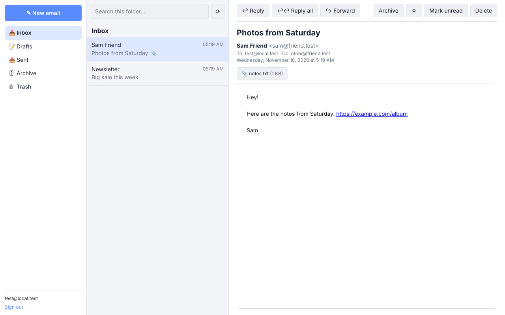

# Xurqxys Mail

A simple desktop email app. It signs in to the email account you already have
(Gmail, Yahoo, iCloud, or any provider with IMAP/SMTP) and lets you read, send,
reply, forward, search, star, archive and delete real email.



## Run it

```bash
cd email-app
npm install
npm start
```

Build a Windows installer with `npm run dist:win` (output goes to `email-app/dist/`).

## Signing in

| Provider | What to enter as the password |
|---|---|
| **Gmail** | An **app password**: Google Account → Security → turn on 2-Step Verification → *App passwords* → create one. Your normal Gmail password will be refused. |
| **Yahoo** | An app password: Account security → *Generate app password*. |
| **iCloud** | An app-specific password from appleid.apple.com → Sign-In and Security. |
| **Outlook / Hotmail** | Microsoft has turned off password sign-in for most personal Outlook.com accounts, so this usually fails. Work/school accounts with IMAP enabled can work. |
| **Other** | Pick *Other (IMAP/SMTP)* and enter your provider's server names and ports. |

The provider is picked automatically from your email address.

## Features

- Folders with unread counts (Inbox, Sent, Drafts, Archive, Trash, and your own folders)
- Message list with paging (“Load older messages”) and server-side search
- New mail shows up live (IMAP IDLE), with a desktop notification when the window isn't focused
- Read HTML and plain-text email, save attachments
- Compose, reply, reply all, forward, attach files, save drafts
- Star, mark unread, archive, delete (moves to Trash)
- Sent mail is saved to your Sent folder
- Keyboard: `n` new, `r` reply, `j`/`k` or arrows to move, `Del` delete, `/` search, `F5` refresh, `Ctrl+Enter` send, `Esc` close

## Privacy and safety

- Your password is stored only on your computer, encrypted with the operating system's
  keychain (Electron `safeStorage`). *Sign out* deletes it.
- The app talks directly to your mail provider. There is no server in between.
- Emails are shown in a sandboxed frame: scripts in emails never run.
- Remote images (often used to track whether you opened an email) are blocked until you click *Show images*.
- Links in emails open in your normal browser.

## How it's built

| File | Role |
|---|---|
| `main.js` | Electron main process: window, account storage, IPC handlers |
| `mail.js` | IMAP (imapflow) and SMTP (nodemailer) logic |
| `preload.js` | The small, safe API the UI is allowed to call |
| `src/` | The interface (HTML/CSS/JS, no framework) |

## Not done yet

- One account at a time
- Plain-text compose (no bold/italic editor)
- No "Sign in with Google/Microsoft" (OAuth). That would remove the need for app passwords
  and make Outlook.com work, but requires registering the app with Google and Microsoft.
